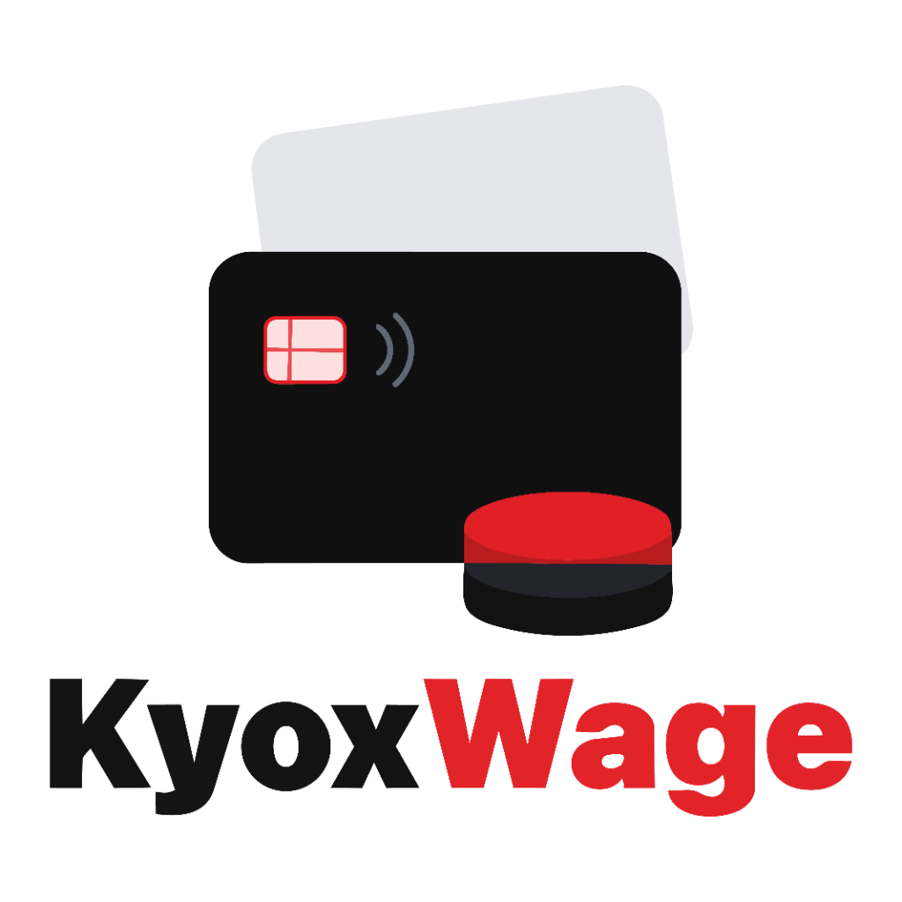

# KyoxWage 💳

  

  <strong>Smart Personal Salary & Budget Analytics Application</strong> 
  <em>Engineered & Developed by <strong>KyoxDev</strong></em>

  

---

## 📥 Direct Download (Android APK)

Download the official release APK directly to your Android device:

| Release | Version | Direct Download Link | Size |
| :--- | :---: | :--- | :---: |
| **KyoxWage Android Release** | `v1.0.0` | **[⬇️ Download KyoxWage-v1.0.0.apk](https://github.com/KavishkaPKP/KyoxWage-Releases/releases/download/v1.0.0/KyoxWage-v1.0.0.apk)** | ~53 MB |

---

## ✨ Features & Highlights

* **📊 Smart Financial Dashboard:**
  * Real-time salary surplus & deficit tracking.
  * Interactive category-wise expense donut charts.
  * Fast month switcher for full historical review.

* **🔄 Month-over-Month Comparative Analytics:**
  * Side-by-side KPI cards (Income, Expense, Net Savings) comparing any two months.
  * 5-month income vs expense bar trend graphs.
  * Category delta tracking showing where you saved and where expenses grew.

* **💡 50 / 30 / 20 Budget Rule Engine:**
  * Automated calculation of Needs (50%), Wants (30%), and Savings (20%).

* **➕ Dynamic Custom Categories:**
  * Pre-loaded with Utility Bills, Water Bills, Vehicle Finance, and Bank Loans.
  * Create unlimited custom categories with personalized iconography and colors.

* **🔔 Automated Payday Push Notifications:**
  * Configurable monthly salary day alerts.
  * Runs 100% on-device with zero server or SMS costs.

* **🔒 Military-Grade AES-256 Vault Encryption:**
  * All transaction and salary records are encrypted on-device with 256-bit AES-CBC.
  * Zero plain-text financial data is stored on disk.

* **☁️ Seamless Google Cloud Backup:**
  * Easily restore all your transactions, categories, and settings when switching or formatting devices.

---

## 📱 How to Install the APK on Android

1. Download **[KyoxWage-v1.0.0.apk](https://github.com/KavishkaPKP/KyoxWage-Releases/releases/download/v1.0.0/KyoxWage-v1.0.0.apk)** to your Android smartphone.
2. Tap the downloaded APK file in your notification bar or file manager.
3. If prompted by Android, enable **"Allow from this source"** (Install unknown apps) in your device settings.
4. Tap **Install** and launch **KyoxWage**!

---

## 🏢 About KyoxDev

  

KyoxWage is proudly engineered and maintained by **KyoxDev**.

* **Customer Support & Inquiries:** `support.kyoxdev@gmail.com`
* **Release Repository:** [https://github.com/KavishkaPKP/KyoxWage-Releases](https://github.com/KavishkaPKP/KyoxWage-Releases)

---

## 📄 License & Privacy

Copyright © 2026 KyoxDev. All rights reserved.
All user data is encrypted and remains strictly confidential to the individual user.
